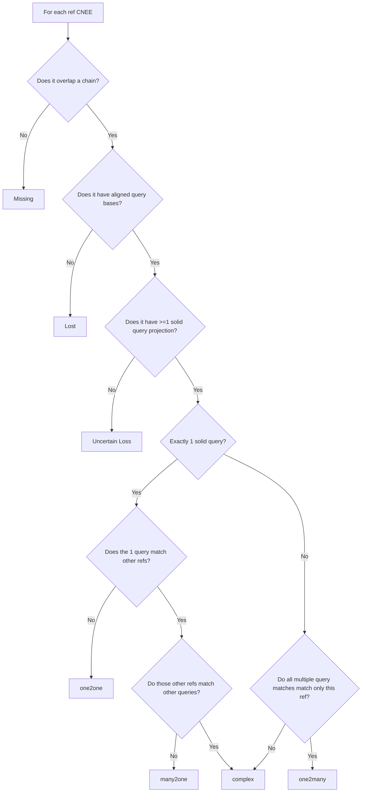
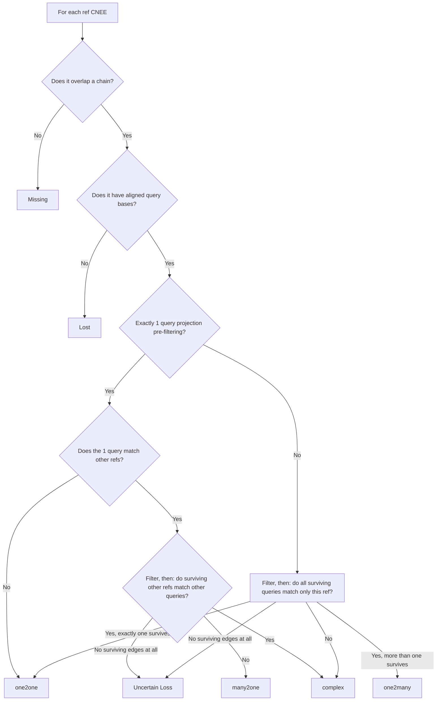

# GOAL
For each candidate projection to query, give it a query ID and classify it into different orthology relation categories between each reference and query CNEEs

# Filtering criteria
A lone ref/query edge (a ref CNEE with exactly one candidate projection, to a
query locus no other ref CNEE also lands on) is never filtered -- it is
always reported as one2one, with its own sequence_identity/gap_fraction
exposed as output columns (see Output) rather than gated on them, so
filtering can happen post-hoc if desired.

Anything with more than one candidate projection -- one2many, many2one, or
complex/many2many by initial graph shape -- goes through relative-score
filtering ("Modified relative scoring algo" in `spurious_hit_filtering.md`;
`toga4cnee.spurious_filter`, wired into
`toga4cnee.orthology.classify_orthology` as `filter_multi_projections`).
It works per query locus (the merged query span of the eligible
projections landing there), scoring every chain aligned at that locus once:
- Soft depth filter: of the chains overlapping the locus, only the top 20
  (`--soft-depth-limit`) by chain score that actually have aligned bases
  there are scored; a projection on any other chain is pruned as
  repeat-driven (`high_depth_low_chain_rank`).
- If only one chain aligns there, its projection is kept only if its
  surrounding flanks have real aligned-block coverage from ANY chain
  (`no_flank_support` otherwise).
- Otherwise, each chain's local score = sequence identity over the locus x
  aligned fraction over the locus plus 10kb flanks each side; a projection
  is kept if its chain's score is > 0.5 (`--relative-score-threshold`) of
  the best chain's at that locus (`low_relative_score` otherwise). Several
  chains can pass at one locus, so many2one calls can survive filtering.

# Orthology categories:
## Ref CNEE categories
- one2one: CNEE single copy in both query and ref; passes filtering criteria
- one2many: single copy in ref, multicopy in query; query projections pass filtering criteria
- many2one: multiple ref CNEEs align to same query locus; ref alignments pass filtering criteria
- complex: complex cases where multiple ref CNEEs overlap multiple the same query loci
- unaligned: ref CNEE has NO chain overlaps
- probable loss: ref CNEE overlaps a chain but only in chain gap AND chain gap not a contig boundary
- assembly gap loss: ref CNEE overlaps a chain but only in chain gap and gap is a contig boundary
- ALT: missing/loss: if cannot infer contig boundaries, collapse "probable loss" and "assembly gap loss" into this category
- uncertain loss: ref CNEE has only pruned projections

## Query CNEE categories
- one2one: CNEE single copy in both query and ref; passes filtering criteria
- one2many: single copy in ref, multicopy in query; query projections pass filtering criteria
- many2one: multiple ref CNEEs align to same query locus; ref alignments pass filtering criteria
- complex: complex cases where multiple ref CNEEs overlap multiple the same query loci
- pruned: query projection fails relative-score filtering

## Loss sub-categorization (implemented)
Whether a chain gap is a contig boundary is inferred from the query FASTA
alone (no AGP): scan for N-runs, and see whether one (or a small handful of)
length(s) clearly dominate the runs of at least `--min-gap-length` bases --
see `assembly_gaps.py`. Three outcomes:
- **high confidence** (one dominant length): only that length counts as a
  boundary marker.
- **medium confidence** (a small set of 2-3 lengths together dominate):
  any of those lengths counts as a boundary marker -- some assemblies
  legitimately use more than one fixed-length gap type (e.g. contig-gap vs
  scaffold-gap).
- **none** (too spread out, or too few qualifying N-runs, or no query FASTA
  supplied at all): the probable_loss/assembly_gap_loss distinction can't be
  made confidently, so both collapse into `missing/loss` instead of
  guessing. A given ref's own chain gap can also individually be ambiguous
  (no aligned block on one side within its own chain) and falls back to
  `missing/loss` even when the genome's overall convention is confident.

This sub-categorization (plus per-ref pruning counts and pre-pruning
category) is independent of multi-projection filtering and always runs when
a query FASTA is supplied, written to the ref-CNEE TSV described in
output_files.md. It does not change out_orthology's own "lost"/"unaligned"
labels.

# Implementation
- Create network graph where:
  - each node = query or ref CNEE 
- Draw an edge between ref node to query node (i.e. each alignment)
  - Store edge attributes:
    - sequence_identity
    - fraction_gap
- Determine each ref CNEE's initial (pre-filtering) graph shape from its
  connected component: a lone ref/query edge needs no filtering at all; a
  ref with multiple query edges, multiple refs sharing one query edge, or a
  larger many-to-many component are all "multi-projection" and go through
  the relative-score filtering described above (see Filtering criteria) before
  the graph is re-clustered from the surviving projections.
- for each query node (in the post-filtering graph):
  - get connected ref nodes
  - use info re: connected nodes to assign orthology category and ID for that query node (i.e CNEE):
    - if connected to single ref node that has no other connections, then: "one2one"
      - set query ID as "q_[ref CNEE name]"
    - if connected single ref node and:
      - ref node connects multiple query nodes AND those query nodes only connect this reference
      - then: "one2many"
        - set query ID as "q_[ref DNEE name]_[n]"
    - if connects to multiple ref nodes and those ref nodes only connect this query node, then: "many2one"
    - for now, if none of these criteria met, then: "complex"
  - a ref left with no surviving query edge at all (but that did have some
    projection before filtering) becomes "uncertain_loss"
- for each reference node with 0 chain-overlap candidates:
  - set query CNEE ID to "NA"
  - set orthology category as: "missing"
- for each reference node with chain-overlap candidates but no aligned query bases:
  - set query CNEE ID to "NA"
  - set orthology category as: "lost"

# Output
Tab separated list:
- query CNEE w/ ID
- partner ref CNEE(s) as comma separated list
- orthology category

# Orthology flowchart

"Solid" match for ref vs query projection = sequence identity > 0.7 AND gap fraction < 0.1.
If genome FASTAs are not provided, sequence identity is unavailable and the
solid-match decision uses gap fraction only.

# Orthology flowchart v3
Per-locus relative-score filtering (see Filtering criteria and
`spurious_hit_filtering.md`) runs on every ref CNEE in an ambiguous
(one2many/many2one/complex) component before the graph is re-clustered and
final categories are assigned from the surviving edges; a lone ref/query
edge is never filtered.

