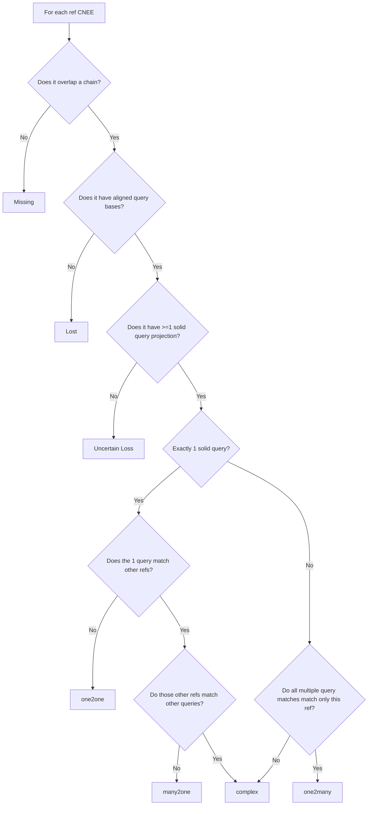
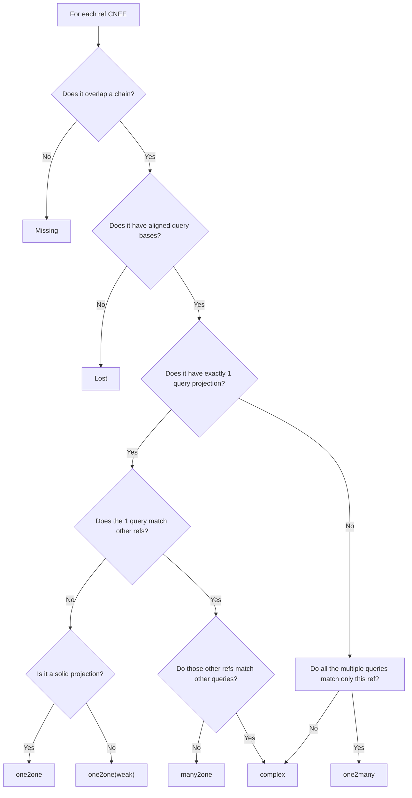

# GOAL
For each candidate projection to query, give it a query ID and classify it into different orthology relation categories between each reference and query CNEEs

# Filtering criteria
Overlap fraction, sequence similarity, number of projections for the CNEE
- provides an "identity threshold" 

# Possible categories:
- one2one: CNEE single copy in both query and ref; passes filtering criteria
- one2many: single copy in ref, multicopy in query; query projections pass filtering criteria
- many2one: multiple ref CNEEs align to same query locus; ref alignments pass filtering criteria
- missing: ref CNEE has NO chain overlaps
- lost: ref CNEE overlaps a chain but has no aligned query bases
- uncertain_loss: ref CNEE has aligned query projection(s), but all are BELOW filtering threshold
- many2many/"complex": complex cases where multiple ref CNEEs overlap multiple the same query loci
  - i.e. a "combo" of many2one and one2many
  - question: how deep to recurse into graph...

# Implementation
- Create network graph where:
  - each node = query or ref CNEE 
- Draw an edge between ref node to query node (i.e. each alignment)
  - Store edge attributes:
    - sequence_identity
    - fraction_gap
  - A "solid" edge passes the current filtering thresholds
- for each query node:
  - get connected ref nodes
  - use info re: connected nodes to assign orthology category and ID for that query node (i.e CNEE):
    - if query node has at least 1 solid edge:
      - if connected to single ref node that has no other connections, then: "one2one"
        - set query ID as "q_[ref CNEE name]"
      - if connected single ref node and:
        - ref node connects multiple query nodes AND those query nodes only connect this reference
        - then: "one2many"
          - set query ID as "q_[ref DNEE name]_[n]"
      - if connects to multiple ref nodes and those ref nodes only connect this query node, then: "many2one"
      - for now, if none of these criteria met, then: "complex"
    - else if query node only has non-solid edge(s), then: "uncertain_loss"
- for each reference node with 0 chain-overlap candidates:
  - set query CNEE ID to "NA"
  - set orthology category as: "missing"
- for each reference node with chain-overlap candidates but no aligned query bases:
  - set query CNEE ID to "NA"
  - set orthology category as: "lost"

# Output
Tab separated list:
- query CNEE w/ ID
- partner ref CNEE(s) as comma separated list
- orthology category

# Orthology flowchart

"Solid" match for ref vs query projection = sequence identity > 0.7 AND gap fraction < 0.1.
If genome FASTAs are not provided, sequence identity is unavailable and the
solid-match decision uses gap fraction only.

# Orthology flowchart v2

